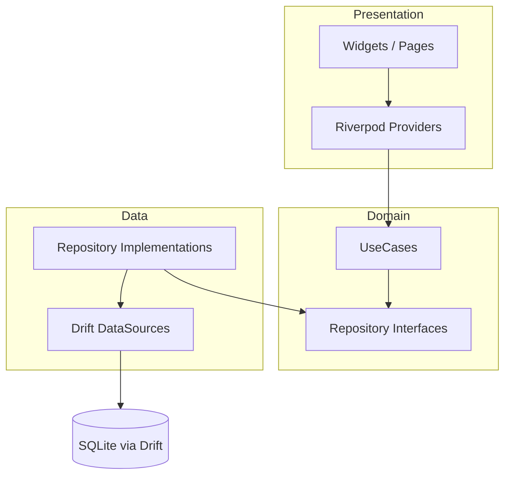
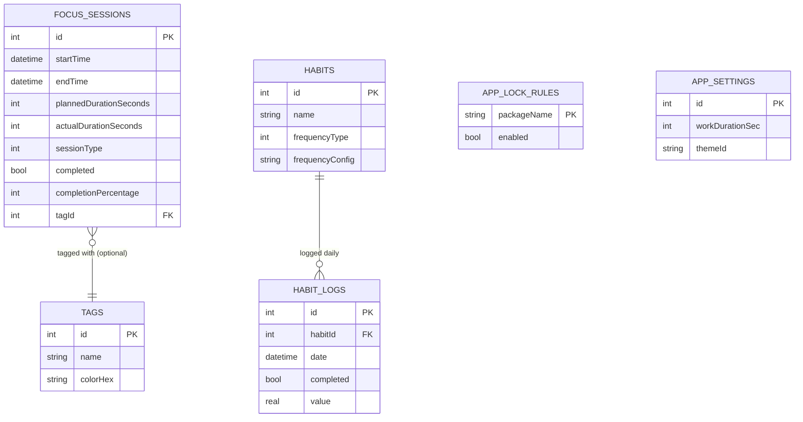
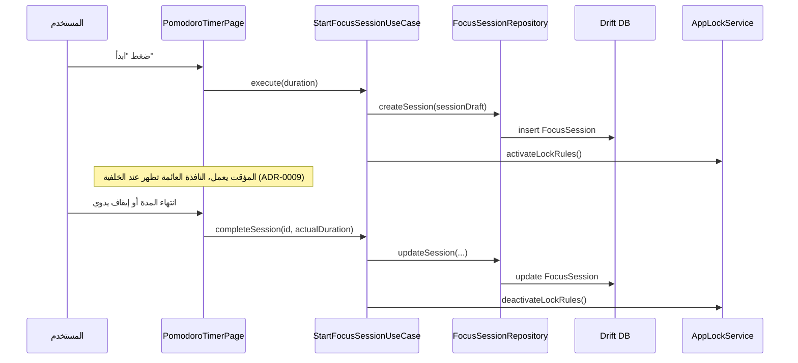

# المخططات (Diagrams)

هذا المستند يحتوي المخططات الأساسية الكافية لبدء التنفيذ. مخططات إضافية (تسلسل عمليات لميزة معينة، حالات واجهة معقدة...) تُضاف لاحقًا **عند بناء تلك الميزة تحديدًا**، وليس كلها دفعة واحدة الآن — إضافتها مسبقًا بدون سياق فعلي غالبًا ستحتاج تعديلًا بعد أول تطبيق حقيقي على أي حال.

## 1. مخطط الطبقات المعماري (Architecture Layers)

## 2. مخطط العلاقات بين الجداول (ER Diagram)

## 3. مخطط تسلسل: دورة حياة جلسة بومودورو واحدة

## متى نضيف مخططات جديدة؟

- **مخطط تسلسل جديد**: عند بناء أي ميزة فيها تنسيق بين أكثر من usecase/service (مثل تدفق استثناء تحسين البطارية، أو تدفق تصدير PDF الكامل من الإحصائيات).
- **مخطط حالة (State Diagram)**: إذا تبيّن أن حالة واجهة معينة (مثل حالات المؤقت: idle/running/paused/completed) معقدة بما يكفي ليصعب تتبعها من الكود مباشرة.
- **القاعدة العامة**: مخطط يُضاف فقط إذا كان سيوفر وقتًا فعليًا وقت التنفيذ أو المراجعة، لا كـ "واجب توثيقي" منفصل عن الحاجة الفعلية.
