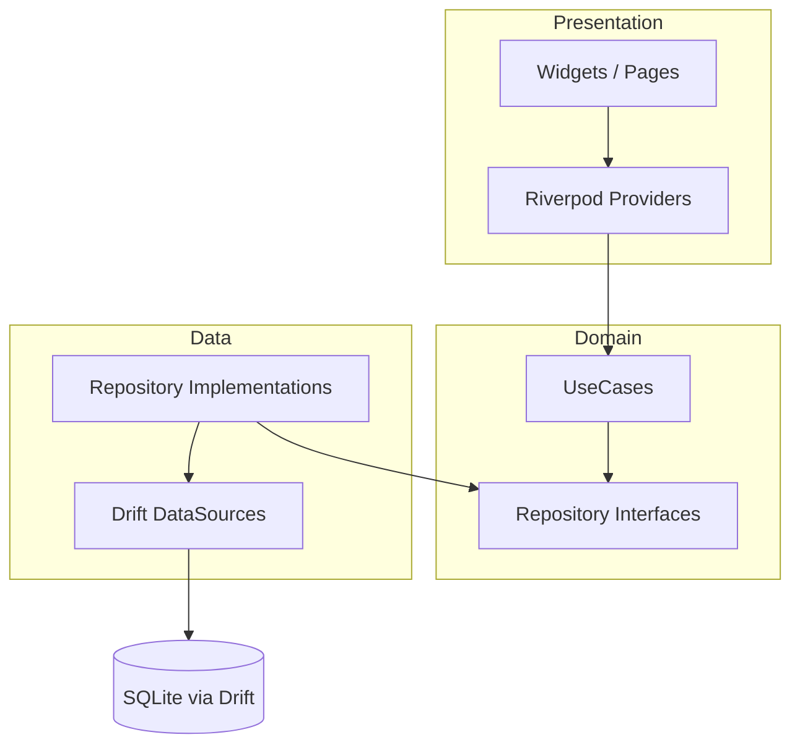
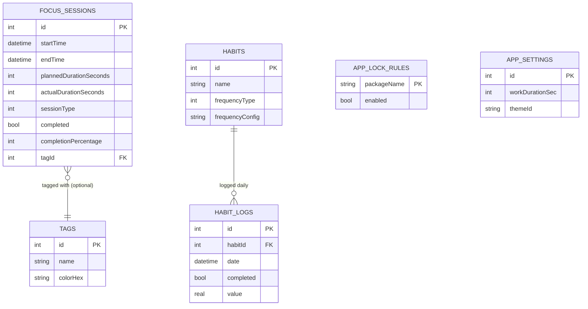
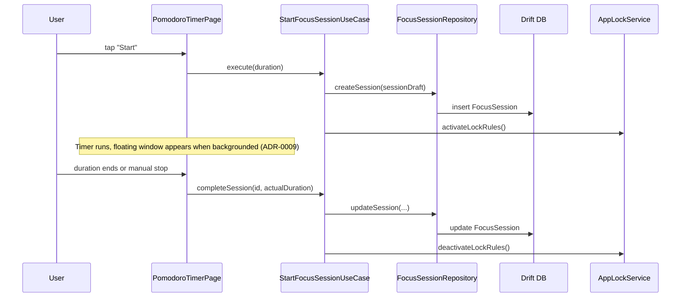

# Diagrams

This document contains the baseline diagrams sufficient to start implementation. Additional diagrams (a process flow for a specific feature, complex UI states...) are added later **when that feature is actually being built**, not all upfront — adding them prematurely without real context would likely need revision after the first real implementation anyway.

## 1. Architecture Layers Diagram

## 2. Entity-Relationship Diagram

## 3. Sequence Diagram: Lifecycle of a Single Pomodoro Session

## When to Add New Diagrams

- **A new sequence diagram**: when building any feature that coordinates more than one usecase/service (e.g. the battery-optimization exemption flow, or the full PDF export flow from statistics).
- **A state diagram**: if a particular UI state (e.g. timer states: idle/running/paused/completed) proves complex enough that tracking it directly in code becomes hard.
- **General rule**: a diagram is added only if it will actually save time during implementation or review, not as a documentation obligation detached from real need.
